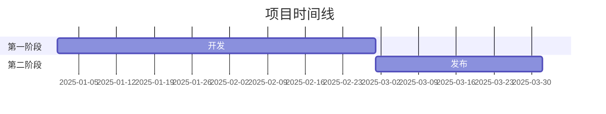
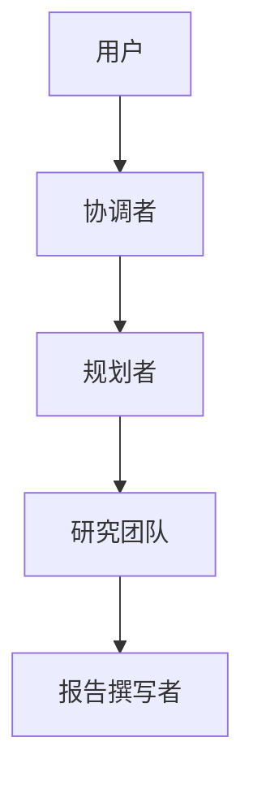
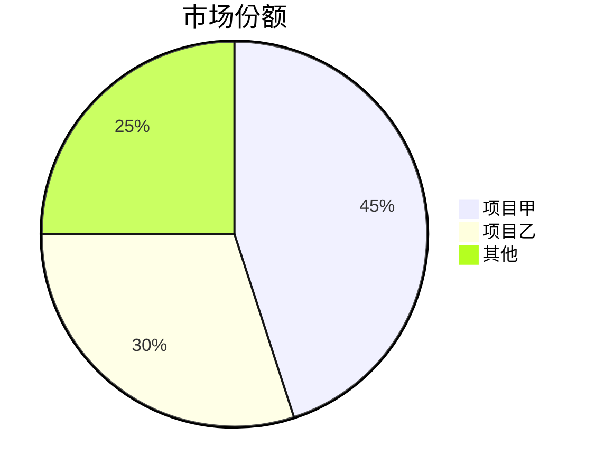

# GitHub 深度研究技能

结合 GitHub API（Application Programming Interface，应用程序编程接口）、web_search、web_fetch 开展多轮研究，生成全面的 Markdown 报告。

## 研究流程

- 第 1 轮：GitHub 接口。
- 第 2 轮：广泛发现。
- 第 3 轮：深入调查。
- 第 4 轮：细节挖掘。

## 核心方法

### 查询策略

**由广到窄：** 先使用 GitHub 接口，再进行一般查询，最后根据发现细化。

```
第 1 轮：GitHub 接口
第 2 轮：“{topic} 概览”
第 3 轮：“{topic} 架构”、“{topic} 与替代方案比较”
第 4 轮：“{topic} 问题”、“{topic} 路线图”、“site:github.com {topic}”
```

**来源优先级：**

1. 官方文档／仓库，权重最高。
2. 技术博客，例如 Medium、Dev.to。
3. 经过核实的新闻媒体文章。
4. 社区讨论，例如 Reddit、Hacker News。
5. 社交媒体，权重最低，仅用于情绪分析。

### 研究轮次

**第 1 轮——GitHub 接口**

直接执行 `scripts/github_api.py`，不要调用 `read_file()`：

```bash
python /path/to/skill/scripts/github_api.py <owner> <repo> summary
python /path/to/skill/scripts/github_api.py <owner> <repo> readme
python /path/to/skill/scripts/github_api.py <owner> <repo> tree
```

**可用命令（作为 `github_api.py` 的最后一个参数）：**

- summary
- info
- readme
- tree
- languages
- contributors
- commits
- issues
- prs
- releases

**第 2 轮——发现（3–5 次 web_search）**

- 获取概况并识别关键术语。
- 找到官方网站／仓库。
- 识别主要参与者和竞争项目。

**第 3 轮——深入调查（5–10 次 web_search，加 web_fetch）**

- 技术架构细节。
- 关键事件时间线。
- 社区情绪。
- 对有价值的地址使用 web_fetch 获取全文。

**第 4 轮——细节挖掘**

- 分析提交历史，重建时间线。
- 阅读问题和合并请求，了解功能演进。
- 检查贡献者活跃度。

## 报告结构

遵循 `templates/report_template.md` 模板：

1. **元数据：** 日期、置信程度和研究对象。
2. **执行摘要：** 2–3 句话概括，并包含关键指标。
3. **时间线：** 按日期分阶段梳理。
4. **核心分析：** 针对主题的深入讨论。
5. **指标与比较：** 表格和增长图。
6. **优势与劣势：** 平衡评估。
7. **来源：** 分类参考资料。
8. **置信度评估：** 按可信程度区分论断。
9. **方法：** 所用研究方式。

### Mermaid 图

有帮助时加入图表：

**时间线（甘特图）：**



**架构（流程图）：**



**比较（饼图／条形图）：**



## 置信度评分

根据来源质量确定可信程度：

| 置信程度 | 标准 |
| --- | --- |
| 高（90%以上） | 官方文档、GitHub 数据、多个来源相互印证 |
| 中（70–89%） | 单一可靠来源、近期文章 |
| 低（50–69%） | 社交媒体、未核实说法、过时信息 |

## 输出

报告保存为：`research_{topic}_{YYYYMMDD}.md`。

### 格式规则

- 中文内容使用全角标点（，。：；！？）。
- 技术术语首次出现时提供百科或文档地址。
- 指标和比较使用表格。
- 技术示例使用代码块。
- 架构、时间线和流程使用 Mermaid。

## 最佳实践

1. **先看官方来源：** 仓库、文档、公司博客。
2. **通过提交／合并请求核实日期：** 通常比文章可靠。
3. **交叉印证论断：** 至少两个独立来源。
4. **指出冲突信息：** 不隐藏矛盾。
5. **区分事实与意见：** 明确标注推测。
6. **关键：始终附行内引用。** 外部来源支持的每个论断后立即使用 `[citation:标题](URL)` 格式。
7. **从搜索结果提取地址：** web_search 返回 {title, url, snippet}，始终使用 url 字段。
8. **边研究边更新：** 不要等到最后才综合整理。

### 引用示例

**好——包含行内引用：**

```markdown
项目上线三个月内获得 10,000 个星标 [citation:GitHub 统计](https://github.com/owner/repo)。
架构使用 LangGraph 编排工作流 [citation:LangGraph 文档](https://langchain.com/langgraph)。
```

**不好——没有引用：**

```markdown
项目上线三个月内获得 10,000 个星标。
架构使用 LangGraph 编排工作流。
```
