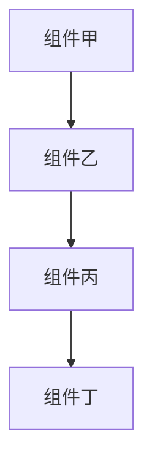

[!NOTE] 使用用户自己的语言生成本报告。

# {TITLE}

- **研究日期：** {DATE}
- **时间戳：** {TIMESTAMP}
- **置信程度：** {CONFIDENCE_LEVEL}
- **研究对象：** {SUBJECT_DESCRIPTION}

---

## 仓库信息

- **名称：** {REPOSITORY_NAME}
- **说明：** {REPOSITORY_DESCRIPTION}
- **地址：** {REPOSITORY_URL}
- **星标数：** {REPOSITORY_STARS}
- **派生数：** {REPOSITORY_FORKS}
- **未解决问题：** {REPOSITORY_OPEN_ISSUES}
- **语言：** {REPOSITORY_LANGUAGES}
- **许可证：** {REPOSITORY_LICENSE}
- **创建时间：** {REPOSITORY_CREATED_AT}
- **更新时间：** {REPOSITORY_UPDATED_AT}
- **推送时间：** {REPOSITORY_PUSHED_AT}
- **主题：** {REPOSITORY_TOPICS}

---

## 执行摘要

{EXECUTIVE_SUMMARY}

**重要：** 每个论断后使用 `[citation:标题](URL)` 格式加入行内引用。例如：
“项目三个月内获得一万个星标 [citation:GitHub 统计](https://github.com/owner/repo)。”

---

## 完整时间线

### 第 1 阶段： {PHASE_1_NAME}

#### {PHASE_1_PERIOD}

{PHASE_1_CONTENT}

### 第 2 阶段： {PHASE_2_NAME}

#### {PHASE_2_PERIOD}

{PHASE_2_CONTENT}

### 第 3 阶段： {PHASE_3_NAME}

#### {PHASE_3_PERIOD}

{PHASE_3_CONTENT}

---

## 核心分析

**重要：** 每个分析观点都应有 `[citation:标题](URL)` 行内引用支持。

### {ANALYSIS_SECTION_1_TITLE}

{ANALYSIS_SECTION_1_CONTENT}

### {ANALYSIS_SECTION_2_TITLE}

{ANALYSIS_SECTION_2_CONTENT}

---

## 架构／系统概览



{ARCHITECTURE_DESCRIPTION}

---

## 指标与影响分析

### 增长轨迹

```
{METRICS_TIMELINE}
```

### 关键指标

| 指标 | 数值 | 评估 |
|--------|-------|------------|
| {METRIC_1} | {VALUE_1} | {ASSESSMENT_1} |
| {METRIC_2} | {VALUE_2} | {ASSESSMENT_2} |
| {METRIC_3} | {VALUE_3} | {ASSESSMENT_3} |

---

## 比较分析

### 功能比较

| 功能 | {SUBJECT} | {COMPETITOR_1} | {COMPETITOR_2} |
|---------|-----------|----------------|----------------|
| {FEATURE_1} | {SUBJ_F1} | {COMP1_F1} | {COMP2_F1} |
| {FEATURE_2} | {SUBJ_F2} | {COMP1_F2} | {COMP2_F2} |
| {FEATURE_3} | {SUBJ_F3} | {COMP1_F3} | {COMP2_F3} |

### 市场定位

{MARKET_POSITIONING}

---

## 优势与劣势

### 优势

{STRENGTHS}

### 待改进方面

{WEAKNESSES}

---

## 关键成功因素

{SUCCESS_FACTORS}

---

## 来源

### 一手来源

{PRIMARY_SOURCES}

### 媒体报道

{MEDIA_SOURCES}

### 学术／技术来源

{ACADEMIC_SOURCES}

### 社区来源

{COMMUNITY_SOURCES}

---

## 置信度评估

**高置信度（90%以上）论断：**
{HIGH_CONFIDENCE_CLAIMS}

**中等置信度（70–89%）论断：**
{MEDIUM_CONFIDENCE_CLAIMS}

**较低置信度（50–69%）论断：**
{LOW_CONFIDENCE_CLAIMS}

---

## 研究方法

本报告采用以下方法：

1. **多来源网页搜索：** 广泛发现和定向查询
2. **GitHub 仓库分析：** 提交、问题、合并请求与活动指标
3. **内容提取：** 官方文档、技术文章、媒体报道
4. **交叉引用：** 通过独立来源验证
5. **时间线重建：** 根据带时间戳的数据梳理
6. **置信度评分：** 按来源可靠性为论断赋权

**研究深度：** {RESEARCH_DEPTH}
**时间范围：** {TIME_SCOPE}
**地域范围：** {GEOGRAPHIC_SCOPE}

---

**报告编制：** DeerFlow 的 GitHub 深度研究
**日期：** {REPORT_DATE}
**报告版本：** 1.0
**状态：** 完成
